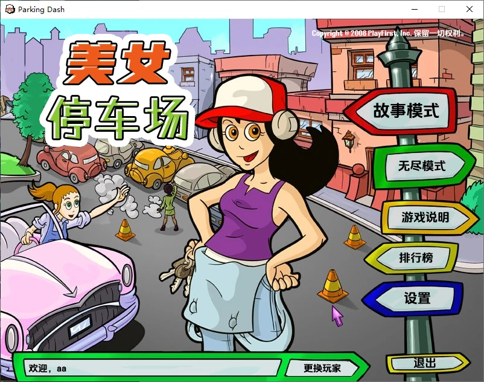
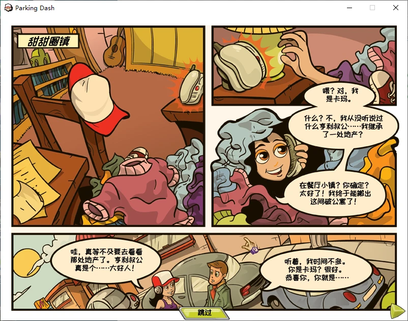
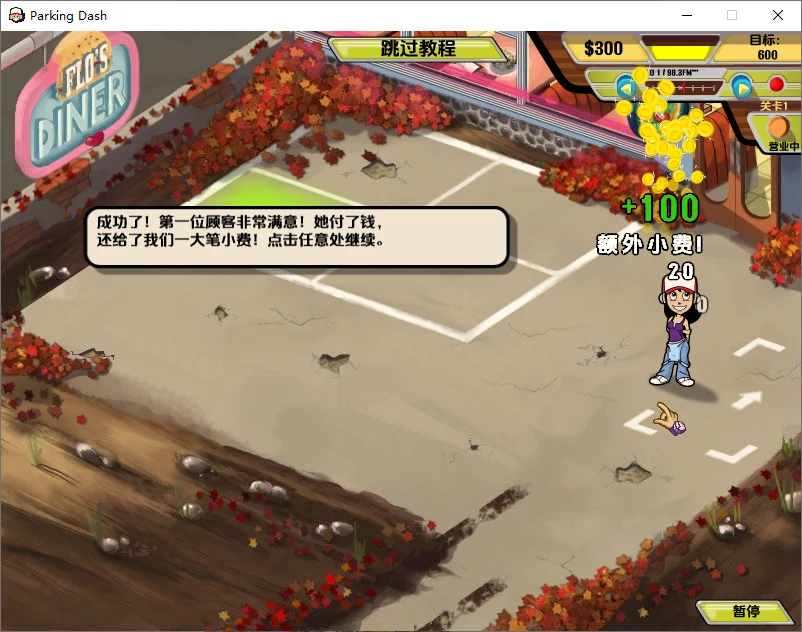

# 美女停车场 · Parking Dash 中文汉化

PlayFirst 2008 年的经营游戏 *Parking Dash*（《美女餐厅》Diner Dash 系列外传，Kef Sensei 开发）的爱好者中文汉化补丁。

- 全部游戏文本：界面、帮助、教程、剧情漫画、关卡开场白、过关台词、道具与装饰说明、电台、奖牌等，约 400 条
- 三套中文字体，字号按原版对齐，中文自动换行、标点避头尾；漫画对白逐句按气泡形状排版
- 重新设计的中文标志《美女停车场》，主菜单背景重绘
- 程序里写死的英文（“欢迎”、“目标/专家”、连击与洗车飘字、最高分等）也已汉化
- 制作人员名单汉化

| 主菜单 | 剧情漫画 | 游戏中 |
|---|---|---|
|  |  |  |

## 下载与安装

到 [Releases](https://github.com/Aden-c/ParkingDashCN/releases) 下载最新的 `ParkingDashCN_vX.X.zip`。

1. 先退出游戏，把压缩包里的全部内容解压到游戏目录（`Parking Dash.exe` 所在的文件夹）
2. 双击 `安装汉化.bat`，原版文件（包括 `Parking Dash.exe`）会自动备份到 `cn_backup`
3. 运行游戏

想恢复英文版，双击 `卸载汉化.bat`。游戏装在 `Program Files` 里的话，请右键“以管理员身份运行”。

### 适用版本

- 资源为**散文件**的版本，和资源打包在 **`assets\assets.pfp`** 里的版本都已实测。补丁文件放在 `assets` 文件夹里，游戏会优先读取它们；卸载时会删掉补丁新加的文件，游戏回到读取 `.pfp` 里的原版。
- `Parking Dash.exe` 的修改是在你的电脑上原位进行的：补丁只记录要改的几十个字节，修改前逐处核对原内容，版本对不上就一个字节都不改（其余汉化照常生效，只是那几处提示保留英文）。

## 制作人员

| 工作 | 成员 |
|---|---|
| 翻译、润色、中文标志设计、图片修补、实机测试 | 艾登 |
| 试译、图片修补、字体排版与程序 | Claude Opus 5.5 |
| 审校 | Gemini 4 Argon |

## 字体

| 用途 | 字体 | 授权 |
|---|---|---|
| 界面、对话、教程 | 金字社真好体 | SIL OFL 1.1（英文和数字保留原版字形） |
| 达成目标提示 | 金字社真好体 | SIL OFL 1.1（数字保留原版字形） |
| 漫画对白 | 站酷快乐体 | SIL OFL 1.1 |
| 少数生僻字的后备字形 | HarmonyOS Sans SC | 华为授权，仅嵌入本补丁使用，请勿提取另作他用 |
| 标志 | 优设标题黑、霞鹜漫黑 | 仅用于标志图片 |

各字体的授权全文随补丁附在 `字体授权` 文件夹中。

## 仓库内容

本仓库只包含汉化成果和工具，**不含任何游戏原版资源**。

```
zh.json            全部译文（key → 中文），翻译的唯一来源
glossary.json      译名表（人名、地名、模式名等）
charset.txt        字体字符集
fonts.json         本游戏的字体配置（用《美女肥皂剧》仓库里的 fonttool 生成 .mvec）
project.json       游戏相关设置：路径、不翻译的条目、打包清单等
strings_tool.py    把译文写回游戏 strings.xml（自动插入中文折行点、预先断行）
translate_sheet.py 导出 / 导入 Excel 翻译表（只导入改过的格子）
proofread.py       导出校对表
boxes.py           各条目的显示空间、排版检查（漫画气泡、帮助页、开场白）
sim_comic.py       不进游戏模拟漫画页排版，输出预览图
prebreak.py        按字体度量预先断行，让多行文字均衡
bytepath.py        引擎按单字节处理的文字（飘字、警告横幅）：借用控制字符码位放汉字
exe_patch.py       原位替换 exe 里写死的英文
luac50.py          Lua 5.0 字节码读写（本游戏改过操作码编号）
lua_patch.py       改漫画文字框的位置
credits_tool.py    生成制作人员名单
logo/inpaint.py    擦掉主菜单原版标志、修补背景（LaMa 模型 + 手工规则）
make_patch.py      打包发布用的补丁
```

### 自己构建

需要 Python 3.10+，以及 `pip install fonttools openpyxl jieba numpy pillow opencv-python scipy psd-tools onnxruntime`。
字体工具 fonttool 在 [SoapOperaDashCN](https://github.com/Aden-c/SoapOperaDashCN) 仓库里，用环境变量 `FONTTOOL` 指向它的 `fonttool/fonttool.py`。

工具默认的目录结构是：本仓库放在游戏目录里，原版文件放在仓库的 `backup/` 和 `original/` 里（不上传）：

```
Parking Dash/              游戏（资源为散文件）
├─ Parking Dash.exe
├─ assets/
└─ hanhua/                 本仓库
   ├─ backup/              原版 strings.xml、脚本、图片、exe 的备份（自行从游戏复制）
   └─ original/            原版字体 .mvec
```

```
python strings_tool.py apply      把 zh.json 写进游戏
sh build_fonts.sh                 生成并安装全部字体
python exe_patch.py               修改 exe 里写死的英文
python lua_patch.py               调整漫画文字框位置
python credits_tool.py            生成制作人员名单
python make_patch.py 1.0          打包补丁到 dist/
```

## 技术要点

- 字号：Playground 引擎按字体里**所有字形的总上下范围**归一字号，而不是按大写 H 的高度。
- 换行：引擎对无空格的中文会“超出边界后才折行”。对策是字体里空格设为零宽，写入译文时只在词与词之间（jieba 分词）插入空格作为折行点；漫画和教程气泡还按字体度量预先断行，让各行长短均衡。
- 单字节路径：exe 拼出的飘字和警告横幅按单字节处理文字，UTF-8 汉字会被拆坏。对策是把用到的汉字复制到字体里 ASCII 控制字符的码位上，文本里写这些码位。
- 脚本是改过操作码编号的 Lua 5.0 字节码，`luac50.py` 能逐字节无损读写，用来挪动漫画文字框。
- 主菜单标志区域先用 LaMa 修补模型补底，再按原画结构重画楼群、天际线、树冠和车辆。

## 声明

本项目为爱好者汉化，与 PlayFirst、Kef Sensei 及其关联公司无关。*Parking Dash*、*Diner Dash*、PlayFirst 均为其各自所有者的商标。
请使用自己合法拥有的游戏副本。

## 授权

| 内容 | 授权 |
|---|---|
| 工具代码（`*.py` 等） | [MIT](LICENSE) |
| 译文（`zh.json`、`glossary.json`）、中文标志设计 | [CC BY-NC 4.0](https://creativecommons.org/licenses/by-nc/4.0/deed.zh-hans)：可转载、修改，须署名，不得用于商业用途 |
| 字体 | 各自的授权，见上方“字体”一节 |

游戏原版内容的版权归 PlayFirst / Kef Sensei 所有，不在上述授权范围内。
